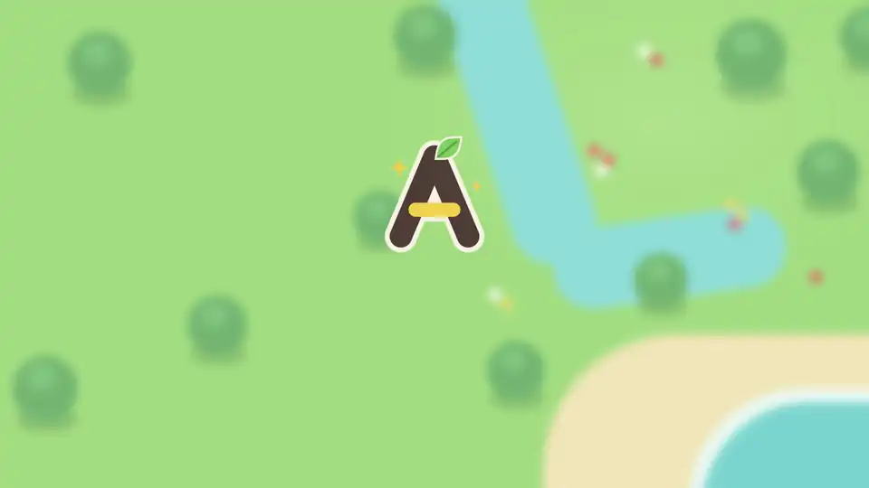
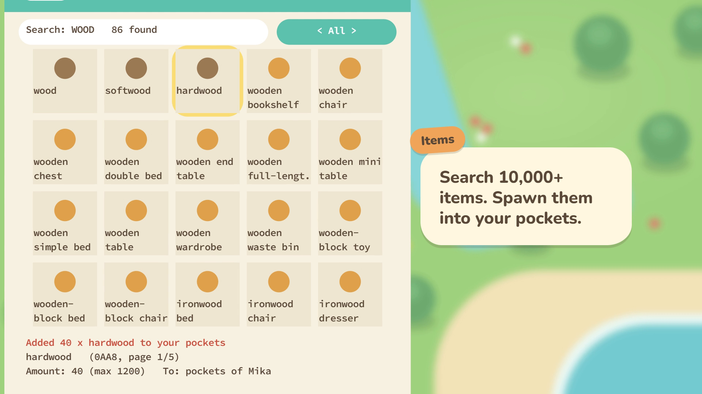
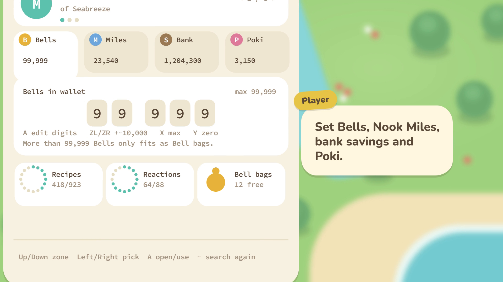
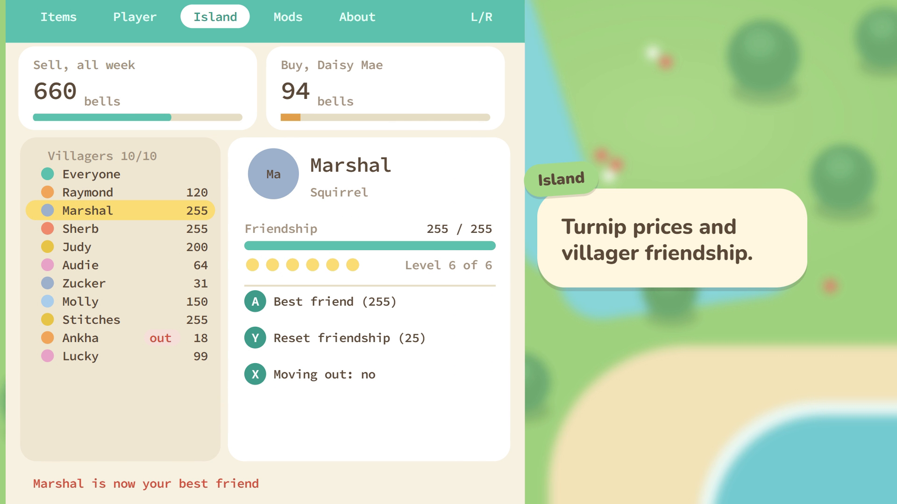
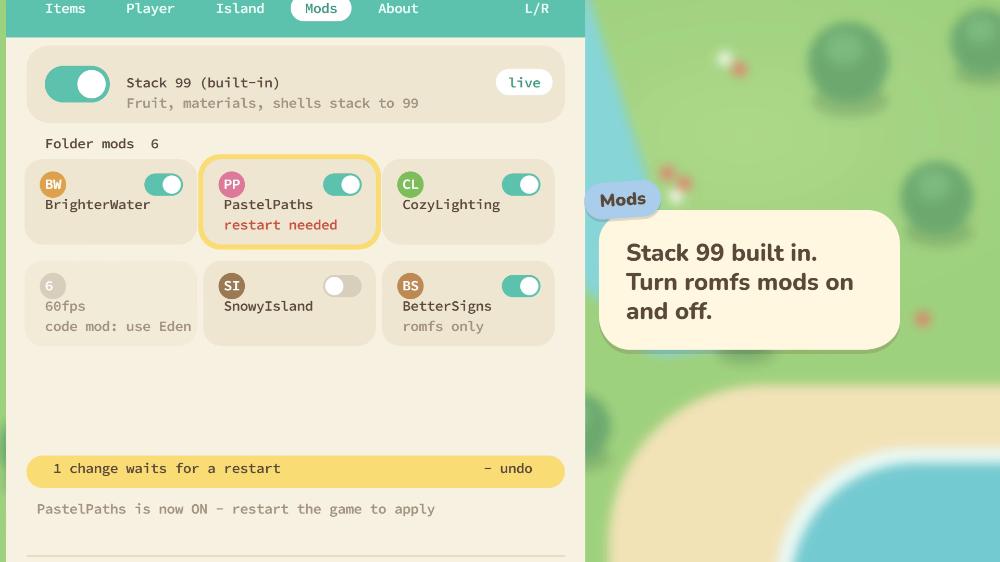

<div align="center">
  
<h1>Aden Modmenu</h1>
<p><strong>An in-game mod menu for Animal Crossing: New Horizons, opened from the Nook Phone.</strong>
<br>
<strong>Runs on <code>Eden</code> · Built for ACNH <code>3.0.2</code> · <code>3.0.3</code> in beta</strong></p>
<br>
<p>
<a href="https://github.com/fr-timothe/AdenModmenuEnhance/actions/workflows/build.yml"></a>
<a href="https://github.com/fr-timothe/AdenModmenuEnhance/releases"></a>
<a href="https://github.com/fr-timothe/AdenModmenuEnhance/releases"></a>
<a href="LICENSE"></a>
</p>
<br>
<p><strong>Quick links</strong></p>
<p>
<a href="#screenshots"></a>
<a href="#features"></a>
<a href="#controls"></a>
<a href="#download-and-install"></a>
</p>
<p>
<a href="#how-it-works"></a>
<a href="#building"></a>
<a href="#credits"></a>
<a href="#license"></a>
</p>

<p align="center">
  
</p>
<p align="center">
  <small>🎥 <a href="assets/showcase/aden-presentation.mp4">Download the 1080p presentation video (MP4)</a></small>
</p>
</div>

## Introduction

Aden Modmenu adds an app to the Nook Phone. Tap it and a menu opens over the game: spawn any item, edit your Bells and Nook Miles, set turnip prices, make every villager your best friend, and turn romfs mods on and off. Everything runs inside the game, with no PC tool and no save editor round trip.

The mod edits the live save data in memory, using the save layout documented by [NHSE](https://github.com/kwsch/NHSE). It finds its hook points by fingerprint at start-up, so it is not tied to one exact game build: if it cannot find them, it switches itself off and the game runs normally.

## Screenshots

<p align="center">
  <em>(Frames from the presentation video, which redraws the menu from its layout code)</em>
</p>

<div align="center">
 <table>
  <tr>
   <td align="center"><strong>Items — search and spawn</strong></td>
   <td align="center"><strong>Player — money and unlocks</strong></td>
  </tr>
  <tr>
   <td></td>
   <td></td>
  </tr>
  <tr>
   <td align="center"><strong>Island — turnips and villagers</strong></td>
   <td align="center"><strong>Mods — mod manager and Stack 99</strong></td>
  </tr>
  <tr>
   <td></td>
   <td></td>
  </tr>
 </table>
</div>

## Features

<details>
  <summary>Items</summary>

- `Search every item` (10,000+ names from `sdmc/aden/items.txt`) with an on-screen keyboard
- `Pocket-style grid` of 5 x 4 tiles a page, with the game's own item icons (game 3.0.3, test)
- `Family filter` on ZL/ZR: Furniture, Clothing, Nature, Materials, Other
- `Spawn into pockets or home storage`, up to 40 full stacks of a stackable item
- `Owned DLC only`: Happy Home Paradise, Pocket Camp and Switch Online items are listed only if you own them
- `Safe by default`: items that need a recipe ID (DIY cards, message bottles) are refused instead of spawned broken
</details>

<details>
  <summary>Player</summary>

- `Every resident` of the island: pick who to edit, and spawned items go to them too
- `Bells, Nook Miles, bank savings and Poki`, with a digit editor and the game's limits (99,999 / 9,999,999 / 999,999,999 / 9,999,999)
- `Learn every DIY recipe` and `every reaction` in one press
- `Fill pockets with Bell bags` (99,000 Bells each)
</details>

<details>
  <summary>Island</summary>

- `Turnip prices`: the sell price for the whole week and Daisy Mae's buy price, with the week's chart
- `Villager friendship`: best friend (255) for one villager or for everyone, or reset (25)
- `Moving-out flag` on and off
- `Remove every weed` on the island map in one press (weeds near you vanish after a loading screen)
</details>

<details>
  <summary>Mods</summary>

- `Mod manager` for romfs mods in `sdmc/aden/mods/<name>/romfs`: on/off from the game, applied at the next start
- `Undo` with Minus: every change since the game started goes back, no restart needed
- `Stack 99` built in: fruit, materials, shells and other safe items stack to 99 (from the Stack99 mod by PlebGeneral). Turning it off splits oversized stacks first
</details>

<details>
  <summary>Under the hood</summary>

- `Loading page` that shows each place the player and island searches look, and what they found
- `Hook points found by fingerprint`, so a game update does not break the mod right away
- `Log file` at `sdmc/aden/log.txt` for bug reports
- `Custom animated "A" app icon` on the Nook Phone
</details>

## Controls

| Where | Buttons |
|---|---|
| Everywhere | `L` / `R` switch tab, `B` close the menu |
| Items | D-pad move, `ZL`/`ZR` family, `-`/`+` amount, `Y` search, `X` pockets or storage, `A` give |
| Player | `Up`/`Down` zone, `Left`/`Right` entry, `A` digits or learn, `ZL`/`ZR` big step, `X` max, `Y` zero, `-` search again |
| Island | `Left`/`Right` sell or buy, `-`/`+` 10, `ZL`/`ZR` 100, `X` best price, `Y` zero; on a villager `A` best friend, `Y` reset, `X` moving out; on Weeds `A` remove them all |
| Mods | D-pad move, `ZL`/`ZR` page, `A` on/off, `-` undo, `Y` rescan |
| About | `ZL`/`ZR` page (Info, Credits), `A` item icons on/off on Info |

## Download and install

Builds are on the [Releases page](https://github.com/fr-timothe/AdenModmenuEnhance/releases). Each release has an `AdenModmenu-<tag>.zip` with a `README.txt` and two folders, `load/` and `sdmc/`. It is a complete install: `subsdk9`, `main.npdm`, `items.txt`, and the phone app name and icon.

1. Open the Eden user folder: in Eden, **File > Open Eden Folder**. It is usually `%APPDATA%\eden`. A portable Eden uses the `user` folder next to `eden.exe`. The `load` and `sdmc` folders are in there.
2. Drag the `load` and `sdmc` folders from the zip into the Eden user folder. Merge them with the existing folders when asked.
3. Start the game.

The zip puts the mod in `load/01006F8002326000/AdenModmenu/exefs/` and the SD files in `sdmc/aden/` (romfs mods go in `sdmc/aden/mods/`). To check, right-click Animal Crossing in Eden and choose **Open Mod Data Location**: `AdenModmenu` must be listed.

If an older version is installed under another folder name (e.g. `AdenModmenu_v0.5.3`), delete that folder first: two copies of the mod conflict.

The game-derived files (`main.npdm`, `items.txt`, `sdmc/aden/romfs`) are not in this repo. The release workflow takes them from a private draft release named `game-files` (`gamefiles.zip`, with `exefs/` and `sdmc/aden/`). To rebuild them from your own dump, see [Building](#building).

## How it works

The mod is a `subsdk9` module loaded next to the game. At start-up it:

1. finds the game's code and **locates its hook points by fingerprint** (`src/sigs.c`,
   generated by `tools/sig.py`), so it isn't tied to one exact game build;
2. maps a writable alias of the code (`svcMapProcessMemory`, `src/hook.c`) and installs
   branch hooks with relocated trampolines;
3. takes over phone app slot 16 (`src/phone.c`), draws its UI with the game's own debug text
   and primitive renderers (`src/gfx.c`, `src/menu.c`) and reads the controller (`src/input.c`);
4. edits the live save data in memory, using the save layout documented by NHSE
   (`src/player.c`);
5. serves replacement game files from the SD card (`src/romfs.c`), which also powers the mod manager.

It's plain C with no devkitPro or libnx: the SDK functions it needs are imported by name
(`src/nn.h`) and system calls are in `src/svc.s`.

| File | What it does |
|---|---|
| `src/main.c` | entry point, start-up order |
| `src/sigs.c`, `src/sigs_data.c` | code fingerprints and the runtime search |
| `src/hook.c` | code aliasing, hooks, trampolines |
| `src/phone.c` | Nook Phone app integration |
| `src/gfx.c`, `src/menu.c` | rendering and the menu UI |
| `src/icons.c` | the game's item icons in the Items grid |
| `src/input.c` | controller input |
| `src/player.c` | player and island save data |
| `src/romfs.c` | file redirection and the mod manager |
| `src/stack.c` | Stack 99: patches the game's ItemKind table in memory |
| `src/tables.c` | recipe, reaction and villager tables (generated from NHSE) |
| `src/log.c` | the log file, `sdmc/aden/log.txt` |

## Building

Needs **clang + ld.lld** (LLVM 15+) and **elf2nso** from
[switch-tools](https://github.com/switchbrew/switch-tools).

```sh
ELF2NSO=/path/to/elf2nso ./build.sh      # -> out/subsdk9
```

Every push and pull request is built by [`build.yml`](.github/workflows/build.yml). Pushing a `v*` tag runs [`release.yml`](.github/workflows/release.yml), which builds the zip and publishes the release (a tag with a `-` suffix is a pre-release).

### Files you make from your own game dump

This repo contains **no Nintendo files**. Dump your own copy of the game (RomFS and ExeFS) and run:

| Output | Command |
|---|---|
| `main.npdm` (adds SVC permissions) | `python3 tools/patch_npdm.py <exefs>/main.npdm main.npdm` |
| `sd:/aden/items.txt` | `python3 tools/make_items.py <romfs>/Message/String_USen <out>/items.txt <romfs>/Bcsv` (the Bcsv dir gives stack sizes; without it every item stacks to 1; unpack String_USen.sarc.zs first with `tools/lib/sarc.py`) |
| phone app name | `python3 tools/make_text.py <romfs>/Message <out>/Message USen EUen` |
| phone app icon | `python3 tools/make_icon.py <romfs>/Layout/LMenuDeviceBtn.Nin_NX_NVN.zs assets/A_icon.png <out>/Layout/LMenuDeviceBtn.Nin_NX_NVN.zs` |

The Python tools need Python 3, numpy and Pillow, plus `zstd` and
[astcenc](https://github.com/ARM-software/astc-encoder) on PATH (or set `ZSTD` / `ASTCENC`).

### Regenerating generated sources

- `src/tables.c`: `python3 tools/gen_tables.py /path/to/NHSE` (clone https://github.com/kwsch/NHSE)
- `src/sigs_data.c`: `python3 tools/sig.py <decompressed 3.0.2 main> > src/sigs_data.c`
  (decompress the NSO with `tools/lib/nso.py`)

## Presentation video

The video at the top is a [HyperFrames](https://hyperframes.heygen.com) composition in [`videos/aden-promo/`](videos/aden-promo): plain HTML and GSAP, rendered to MP4 by headless Chrome.

```sh
cd videos/aden-promo
npm run check     # lint, layout and contrast
npm run render    # -> renders/*.mp4
```

## Contributing

Issues and pull requests are welcome. Keep to the conventions of the code around your change:

- Plain C with no devkitPro or libnx; SDK functions are imported by name in `src/nn.h`.
- The build uses `-Wall -Werror`: CI must stay green.
- No Nintendo files in the repo, ever (see `.gitignore`).
- Commit messages in English, imperative, with a short summary line.

To report a bug, attach `sdmc/aden/log.txt` and say which game version you run.

## Credits

- **AdenDev** ([Dev-gu/AdenModmenu](https://github.com/Dev-gu/AdenModmenu)): original author.
- **Timothé Montfrond** ([fr-timothe](https://github.com/fr-timothe)): contributor, maintainer of this fork.
- **NHSE** by kwsch and contributors: save data layout, recipe list, reaction list and villager names. https://github.com/kwsch/NHSE
- **Stack99** by PlebGeneral: the item kinds the built-in Stack 99 switch changes.

## License

[GPL-3.0](LICENSE), the same as NHSE, whose data this project uses.
Animal Crossing is a trademark of Nintendo. This project is not affiliated with Nintendo, and it contains no Nintendo game files.
